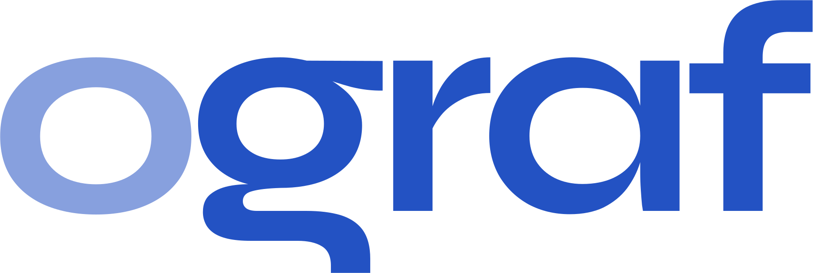
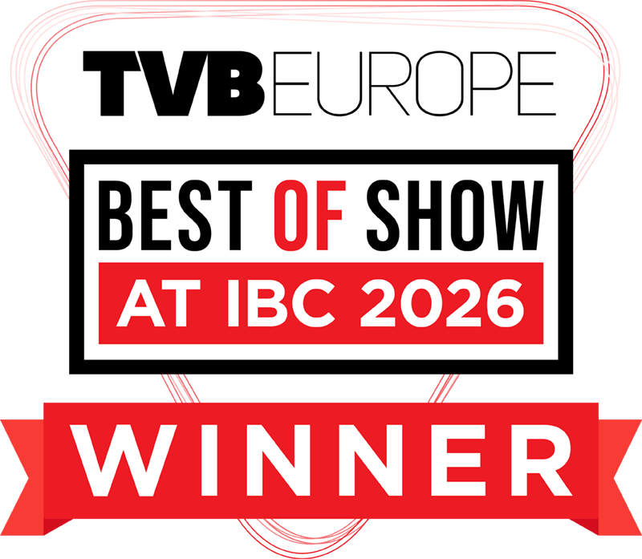
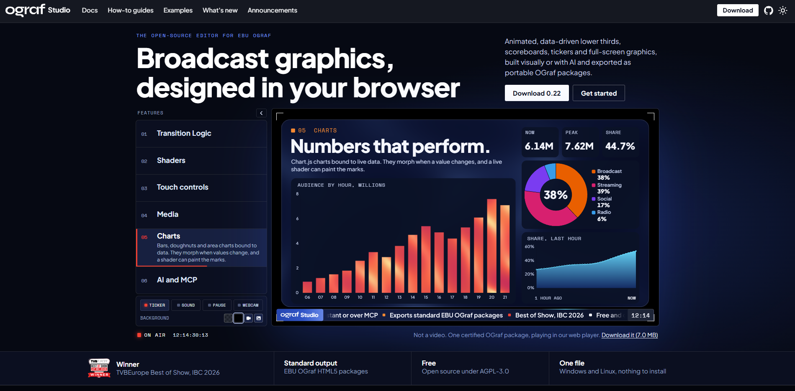

# <picture><source media="(prefers-color-scheme: dark)" srcset="apps/editor/src/assets/ebu-ograf-logo-mono-white.svg"></picture> Studio

<p align="center">
  
</p>

<p align="center"><strong>OGraf Studio won TVBEurope’s Best of Show Award at IBC 2026.</strong></p>

Create animated, data-driven broadcast graphics visually or with AI.

OGraf Studio is an open-source, browser-based editor for EBU OGraf-compatible HTML5 graphics:
lower thirds, scoreboards, tickers, full-screen graphics and reusable templates.

[Download the latest release](https://github.com/zerodensity/ograf-studio/releases/latest) ·
[OGrafStudio.org](https://ografstudio.org/) · [Getting started](#get-started)

[Examples](https://ografstudio.org/examples) ·
[Tutorials](https://ografstudio.org/guides) ·
[Documentation](https://ografstudio.org/docs) ·
[LinkedIn community](https://www.linkedin.com/groups/40618425/)

[](https://ografstudio.org/)

## Key features

- **Template sets** — Save one template or a complete template set as `.ogs`, with thumbnail navigation,
  shared controls/assets, inherited canvas defaults, and a scene explorer.
- **Cropping** — Trim visual layers, image/video sources, and output canvases while preserving
  editable assets and animation.

- **Visual authoring** — Compose text, images, shapes, editable vector paths and Lottie animations
  in a dockable workspace with multi-monitor support.
- **Animation and effects** — Property diamonds, aligned Keys/Graph views, easing, seamless loops,
  text animation, gradients, masks and composable effects.
- **Media and sound** — Paint objects with clips or named live inputs; use frame-based Sound Events
  and shared audio/video playback cues. Preview live sources locally with a webcam.
- **Plugins and charts** — Install versioned chart renderers, animation packs and shader packs from
  `.ogsplugin.zip` bundles. Chart values, paints and supported bar/slice animations remain editable.
- **Reusable designs** — Master Brand Kits, shared typography/background styles, linked components,
  procedural patterns and smart layout modifiers keep template packages consistent.
- **Data and Rules** — Bind operator fields, structured GDD objects and runtime collections;
  build ordered conditions, interactive actions and coordinated template playout.
- **AI with operator control** — Built-in AI chat and external MCP agents use revision-checked
  operations and visual review. The resulting layers and animation remain editable by the operator.
- **Preview and output** — Export checked OGraf packages with browser previews, dockable controls
  and FPS diagnostics; host trusted exports on websites or connect them to Nodos ElectroNode.

## Get started

[Download a single-file server](https://github.com/zerodensity/ograf-studio/releases/latest) for
Windows x64 or Linux x64/ARM64. Run it and open **http://127.0.0.1:4318/**.
On Linux, first run `chmod +x <downloaded-file>`.
No Node.js, npm or Bun installation is needed. Platform verification and signing details accompany each release.

To run from source with Node.js 22+, npm and [Bun 1.3.11](https://bun.sh/):

```sh
npm ci
npm run dev
```

Open **http://localhost:5173/**. See the [development guide](docs/DEVELOPMENT.md) for MCP setup,
building executables and verification.

## Documentation

- [Using Studio](docs/USER_GUIDE.md) — authoring, media, plugins, Rules and playout.
- [AI authoring](docs/AI_AUTHORING.md) — built-in chat, MCP clients and the authoring skill.
- [What's new](docs/releases/0.31.0.md) — 0.31.0 features and compatibility notes.
- [Contributing](CONTRIBUTING.md) — community development and verification.

Contributions target `dev`; maintainers promote tested changes into `stable`, the default branch.

Automated OGraf conformance checks are not EBU certification or a guarantee of compatibility with
every third-party player.

## License

[GNU Affero General Public License v3.0](LICENSE) (`AGPL-3.0-only`).

[Third-party asset credits](docs/THIRD_PARTY.md).
