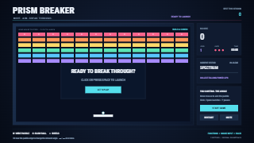

# PRISM BREAKER

An editable brick-breaking game made with OGraf Studio objects, runtime collections, Rules and
a **Breakout state** Function. The bricks, ball, paddle, trails, pickups, score and controls remain
native shapes and text that designers can edit in Studio.

## Play

1. Open [PRISM BREAKER.ogs](<PRISM BREAKER.ogs>) in Studio and choose **Take In** in **Preview & Export**.
2. Click the playfield or the launch button, or focus the preview and press **Space**.
3. Move the mouse inside the playfield to steer the paddle. The pointer uses the template's
   composition coordinates, including when the preview is scaled or fullscreen.

| Control                | Action                                           |
| ---------------------- | ------------------------------------------------ |
| Mouse inside playfield | Position the paddle                              |
| Left / Right arrow     | Hold to move; overrides the mouse until released |
| Click / Space          | Launch the ball; resume a paused game            |
| P                      | Pause / resume                                   |
| R                      | Restart with three lives                         |
| M                      | Mute / unmute                                    |

Moving the mouse over the right-hand controls leaves the paddle in place. Moving focus away from
the preview pauses gameplay and music; resume deliberately when returning. Taking the graphic
out stops its soundtrack. Audio starts after an explicit user gesture, subject to browser audio
permissions. In Studio, **Escape** exits fullscreen.

## Three levels and power-ups

Clear **Spectrum**, **Crosscurrent** and **Core Armor**. Armored bricks need multiple hits. Hits
between paddle rebounds build a scoring combo; missing the ball costs one of three lives. Clear
a level, then launch again for the next pattern. Clearing the third level completes the game.

- **W — Wide paddle:** a wider paddle for twelve seconds.
- **S — Slow ball:** slower travel for ten seconds.
- **+ — Shield:** one save at the bottom of the playfield.

Up to three pickups can be falling at once. Timed effects pause with the game, and a lost life
clears active power-ups. The best score lasts for the current preview session, including restarts.

## Edit in Studio

- **Scene Outliner / Properties:** change the native shapes, typography, colors and layout. The
  bricks use a bounded collection of 72 stable items; actor fields position the ball and paddle.
- **Data:** adjust the palette, trail visibility, music/effect gains and deterministic pickup seed.
- **Rules:** remap keyboard or click events to the named `game.*` custom actions.
- **Window → Functions → Breakout state:** inspect the editable function and its declared input,
  output, action and audio mappings. **Mouse input** supplies a read-only pointer position when
  the function runs; it does not add a separate invocation for every mouse movement.

The Function controls moving positions through ordinary geometry bindings. If you change the
playfield layout, update its matching physics coordinates in the Function as well. Decorations,
typography, colors and button styling can be edited directly as Studio objects.

Readable sources and tests are in [`logic/`](logic/). The template embeds its own function
expression, so gameplay needs neither a separate game server nor a renderer plugin. Its physics
uses a fixed time step and swept collisions, independent of the composition's frame rate.

## Audio and export

**Prism Rush** is an original 128 BPM, thirty-second music loop. The soundtrack and eight sound
effects were synthesized for this example and dedicated to **CC0 1.0**, including their generation
code. No existing game music or external samples were used. Frequent bounce sounds are kept
quiet; adjust the authored audio cues or the music/effect gains to suit the production.

Functions v1 and this example use **standalone, real-time playback**. Export the active template
as a standalone `.ograf.zip`. Coordinated template-set export and non-real-time rendering are
not supported for this example. Keep the `.ogs` as the editable source; saved templates do not
contain a resumed game session.
