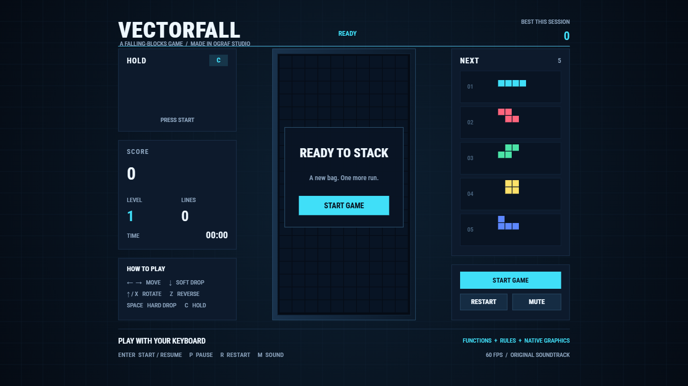

# VECTORFALL

An editable falling-blocks game built with OGraf Studio graphics, reusable components, Rules and
a **Game state** Function. The playfield, score, previews, buttons and effects remain native
Studio objects.

## Play

1. Open [VECTORFALL.ogs](VECTORFALL.ogs) in OGraf Studio.
2. Open **Preview & Export** and choose **Take In**. Fullscreen is optional.
3. Click **Start Game**, or focus the preview and press **Enter**. This first gesture also allows
   the browser to start audio.

| Key                | Action                     |
| ------------------ | -------------------------- |
| Enter              | Start or resume            |
| Left / Right arrow | Move; hold to repeat       |
| Down arrow         | Soft drop                  |
| Up arrow or X      | Rotate clockwise           |
| Z                  | Rotate counterclockwise    |
| Space              | Hard drop                  |
| C                  | Hold or exchange the piece |
| P                  | Pause / resume             |
| R                  | Restart                    |
| M                  | Mute / unmute              |

The on-screen controls also provide Start/Resume, Pause, Restart and Mute. Moving focus away from
the preview pauses the game and music; resume deliberately when returning. In Studio, **Escape**
exits fullscreen, so use **P** to pause. Taking the graphic out stops its audio.

## Edit

- **Scene Outliner / Properties:** edit the native shapes, typography, shader atmosphere and interface
  layout. The **Cell / editable block** component supplies the board, Hold and Next blocks.
- **Data:** the playfield uses one runtime collection of 20 rows, each with ten editable cell
  prototypes. Bound fields update their colors and the score/status text. Game settings include
  palette, ghost-piece visibility, sound levels and the piece-sequence seed.
- **Rules:** keyboard and mouse triggers invoke named `game.*` custom actions. Change these Rules
  to remap the controls or add visual responses.
- **Window → Functions → Game state:** inspect or edit the game logic and its declared data,
  action and audio mappings. Choose **Apply changes** to save an edit, or **Discard draft** to
  abandon it. Playback state is temporary; it is not saved as game progress in the template.

Readable logic sources are in [`logic/`](logic/). The template stores a self-contained function
expression, so playing it does not require a separate game server or a renderer plugin.

## Audio and export

The embedded soundtrack, **Circuit Drift**, is an original 32-second loop. It and the seven sound
effects were synthesized for this example and are provided under **CC0 1.0**. No existing game
music or external samples are used. Adjust the music/effect gains in Data, or edit the authored
audio cues.

Functions v1 and this example use **standalone, real-time playback**. Export the active template
as a standalone `.ograf.zip`; coordinated template-set export and non-real-time rendering are
not supported for this example. Keep the `.ogs` as the editable source.
